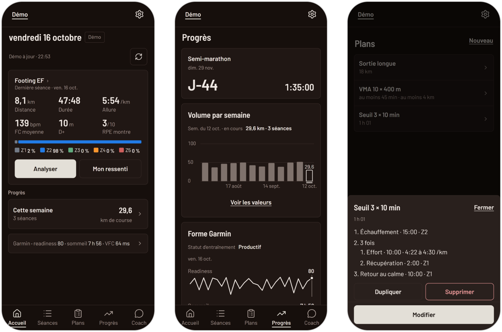
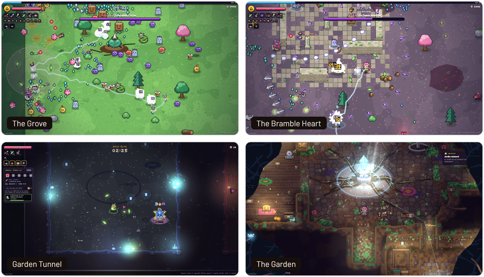
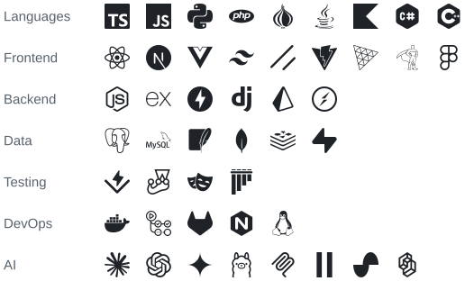

<picture>
  <source media="(prefers-color-scheme: dark)" srcset="assets/header-dark.svg">
  
</picture>

<h3 align="center">Sport Extract</h3>

All your training in one place: Garmin history, fitness metrics, workouts sent to Garmin and an AI coach. React and FastAPI, in production, 1,100+ tests. Private repo.

<h3 align="center">Moss &amp; Mayhem</h3>

A co-op roguelite in the browser, built with <a href="https://github.com/theo-stoffelbach">@theo-stoffelbach</a>: 1 to 4 players, up to 8 with AI mercenaries in the Garden Tunnel. No game engine and no asset files: pixel art written as code and drawn on Canvas 2D, sound and music synthesized with WebAudio. Online co-op runs on a Node.js server over WebSockets, with Discord and Google sign-in.

  <picture>
    <source media="(prefers-color-scheme: dark)" srcset="assets/stack-dark.svg">
    
  </picture>

<a href="https://www.linkedin.com/in/lucas-remery">LinkedIn</a>

